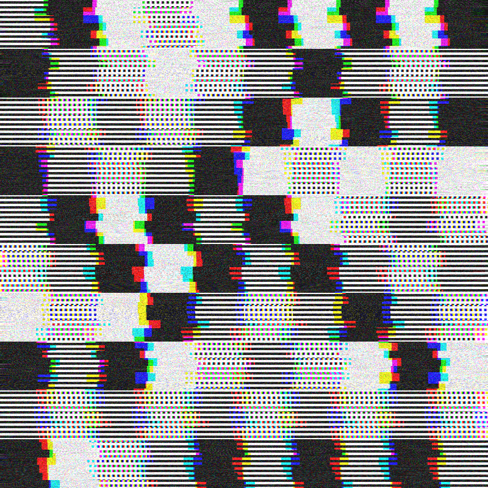

# p5 in Blender

Write **p5.js sketches inside Blender** and use the live canvas as a texture on any
mesh, mapped through UVs. The 2D canvas is the window; UV islands decide where that
window opens on your model.

[中文说明](README.zh.md) · [Download](../../releases/latest) · [Third-party notices](THIRD-PARTY.md)



## Download and install

1. **[Download the latest release](../../releases/latest)** → pick `p5inBlender-<version>.zip`
   (do not unzip it).
2. Blender 4.2+ → `Edit → Preferences → Get Extensions → Install from Disk…`.
3. Enable **p5 in Blender**, then open the 3D View sidebar with `N` → `p5inBlender`.

## 30-second quick start

1. `Sketch` panel → **Start**. A hidden browser starts streaming to Blender.
2. `Sketch` panel → **Edit** — the sketch opens in the Text Editor. Replace it with:

```js
function sketch(p) {
  p.setup = function () {
    p.createCanvas(640, 360);
  };
  p.draw = function () {
    p.background(10);
    p.fill(120, 220, 255);
    p.circle(p.width / 2 + p.sin(p.frameCount * 0.05) * 120, p.height / 2, 60);
  };
}
```

3. `Canvas` panel → **Show** to see it live, **Window Plane** to get a 2×2 canvas,
   then **Bind Mesh** to put the canvas on whatever you selected.

Stop typing and the sketch re-runs within ~0.3 s (*Auto Run on Edit*). Nothing to
configure if you just want pixels on a plane.

Want to see Blender move the sketch? Track an empty:

```js
p.draw = function () {
  p.background(8);
  const objects = (p.p5inblender.state.objects || []);
  objects.forEach(o => p.circle(o.x * p.width, o.y * p.height, 20));
};
```

`Tracking → Track Selected` on any empty feeds `state.objects`.

## What it does

- A real browser runs your sketch (p5.js 1.x or 2.x) — Blender receives the pixels
  every frame over a local socket.
- Frames land in an `Image` datablock, so the Image Editor, EEVEE, Cycles and the
  viewport all show the canvas live.
- No JavaScript engine in Blender: the browser is the runtime, the add-on is the
  bridge.
- Bidirectional: JavaScript reads Blender state (tracked objects, geometry, an
  upstream texture), Blender writes the canvas back to an image.

## Use your own p5 code

Most sketches from p5js.org just work. Add a header line when it is not a plain
instance-mode sketch:

```js
// @lib https://cdn.jsdelivr.net/gh/antiboredom/p5.riso@master/lib/p5.riso.js
// @mode global      // classic setup()/draw() at top level (most old examples)
// @p5 2             // run on p5 2.x + p5.js-compatibility add-ons
```

## The canvas coordinate system

The canvas is a **2×2 square lying flat on XY** (exactly like `Add → Mesh → Plane`).
Everything is relative to it — the camera does not matter:

```
u = local x / 2 + 0.5        v = 0.5 − local y / 2
visible = u, v ∈ [0, 1]      depth = height above the canvas (along its normal)
```

The sketch image is letterboxed inside the square (uniform scale, never stretched),
so `u, v` are coordinates **inside the image**, not inside the square.

## Material

New canvases get a Principled material with:

- `Image → Base Color` **and** `Emission Color` (visible without lights),
- `Image.Alpha → P5B Alpha Ramp → Alpha` (blended, so transparent sketches stay
  transparent in Blender),
- a detached `P5B Color Ramp` you can wire in for duotone/palette looks.

`Canvas → Reset Material` rebuilds it in place. Hand-edited materials are never
overwritten automatically.

## Panels

| Panel | Contents |
|---|---|
| **Sketch** (first) | status line, Start/Stop, Run/Edit, sketch picker, Follow Edited Text, Edit Externally, Reset Demo |
| **Canvas** | Show, Window Plane, Bind Mesh, Reset Material, Standardize Canvas, Show Live Info, Texture + “Use Own Canvas as Texture”, host Open/Background/Close, port/size |
| **Tracking** | Track Selected, Send Geometry, tracked/on-screen counts |
| **Render** | Cook, Cook + Render, Render Animation (deterministic per-frame pulls) |
| **Instances** | several independent canvases, each with its own text/image/material/port |

## Working in an external editor

Blender's text editor only has Python syntax rules, so JavaScript stays plain.
`Sketch → Edit Externally` saves the sketch to `//p5inblender_sketches/`, opens it in
your OS editor (VS Code gives real JS highlighting + the `p5.vscode` API
completion), and syncs your saves back into Blender within ~0.3 s.

## p5 versions

- Default: **p5 1.11.3**, vendored in `host/libs/p5.min.js` (works offline).
- `// @p5 2`: runs on **p5 2.4.0** (also vendored) inside a same-origin iframe and
  loads the [p5.js-compatibility](https://github.com/processing/p5.js-compatibility)
  add-ons (`preload`, `shapes`, `data`, `events`) from a CDN, so 1.x-era code keeps
  working.

## Troubleshooting

| Symptom | Check |
|---|---|
| Nothing updates | `Sketch` panel: is the picker pointing at the file you edit? The status line shows `vN` — it must increase. |
| Sketch never appears | `Canvas → Show` to open the live image; check the status line for `sketch:` errors. |
| Picture flickers | Several browser pages are connected; the newest healthy client owns the canvas — close the extra tabs (the `stale` counter tells you). |
| Choppy updates | `stale` growing means a throttled background tab is competing. |
| Panel shows `panel error:` | That line is the actual exception — report it. |
| Slow first update | Every run reloads the sketch in the browser; a heavy `setup()` (shader compile, big graphics) costs time. |

## Development

```
p5inBlender/
├── __init__.py        add-on entry: operators, panels, pump, cook
├── transport.py       one port: HTTP host page + WebSocket frames + raw TCP v1
├── live_image.py      Image datablock writes (sRGB byte passthrough)
├── window.py          UV window plane + default material
├── i18n.py            English/Chinese UI strings
├── host/              browser host (index.html + vendored p5 1.x / 2.x)
└── tools/             release check, synthetic sender, bench, demo sketches
```

Measured on Blender 5.1 / Windows: 640×360 at ~60 fps, 720p ceiling ~127 fps,
cook round-trip 10–52 ms, image upload 0.69 ms (640×360).

## Licence

GPL-3.0-or-later — see [LICENSE](LICENSE). Bundled third-party code (p5.js 1.11.3 and
2.4.0, MIT) is listed in [THIRD-PARTY.md](THIRD-PARTY.md).
