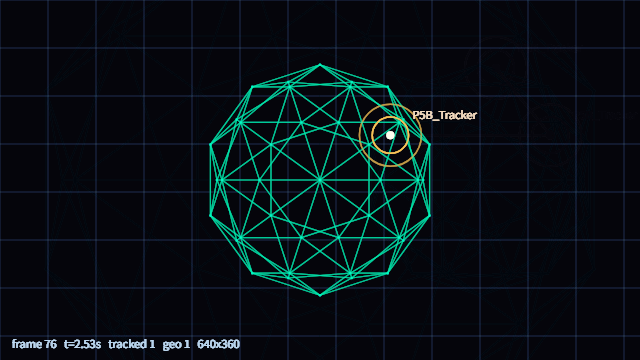

# p5inBlender

[English](README.md) · 中文

把浏览器里的一张 2D 画布（p5.js / canvas 2D / three.js）当作 Blender 的实时纹理，
UV 岛就是这扇"窗口"，着色器在它上面继续加工。

```
sketch (canvas)  --WebSocket/TCP binary-->  Blender 主线程 timer
      |                                          |
   getImageData                             Image datablock (8-bit, sRGB)
      |                                          |
      +-------- 20B header + RGBA8 ------+   Image Texture (Vector <- UV)
                                                 |
                                          Emission / 你接的任何着色器
```

## 为什么是"像素"而不是"把 p5 装进着色器"

GLSL 里没有 JS。五个库只能跑在浏览器（Chromium 内核）里，进着色器的是它们的
像素输出和参数。所以插件由三层组成：JS 运行时 / 传输 / Blender 侧 Image+UV+材质。

## 已实测结论（Blender 5.1.1）

| 写法 | 渲染回来的值 | 结论 |
|---|---|---|
| 8-bit image + colorspace `sRGB`，写入 0.5 | 0.5（128/255） | ✅ 字节直通，就用这个 |
| 8-bit image + colorspace `Non-Color`，写入 0.5 | 0.7379（188/255） | ❌ 会整体偏亮 |
| float image + colorspace `sRGB`，写入 0.5 | 0.7379（188/255） | ❌ 浮点缓冲按线性解释 |

两条硬性顺序要求：

1. `colorspace_settings` / `alpha_mode` 必须在**写像素之前**设置，之后设置会重载缓冲、把数据清空。
2. 图像缓冲是 bottom-up，canvas 是 top-down，写入前要 `[::-1]`。

## 性能（纯写入，不含网络）

| 分辨率 | `pixels.foreach_set` |
|---|---|
| 640x360 | 0.69 ms |
| 1280x720 | 2.44 ms |
| 1920x1080 | 5.55 ms |

## M0 端到端实测（Blender 5.1.1 / Python 3.13.9 / Windows，同机回环）

| 场景 | 源速率 | Blender 侧 | 丢帧 |
|---|---|---|---|
| 640x360，源锁 60fps | 60.0 fps（55.3 MB/s） | **59.5 fps 稳定** | 1 / 720 |
| 1280x720，源不限速 | 373.6 fps（1.38 GB/s） | **127.6 fps 上限** | 按设计丢旧帧 |
| 320x180，WebSocket（浏览器等价路径） | 36.7 fps | 120/120 全部到达 | 0 |

- 720p 的 127.6 fps 上限 ≈ 7.8 ms/帧，含 numpy 转换 + `foreach_set` + `image.update()` + 重绘；**瓶颈不在网络，在 Python 侧转换与 GPU 重传**。
- 队列策略是"丢旧帧、永远显示最新帧"，所以源再快也不会积压成延迟。
- 浏览器端在本会话里无法验证：DSH 沙箱禁止 Chromium 的多进程命名管道（`mojo platform_channel` 拒绝访问）。需要在普通终端里启动 Edge/Chrome。

## M2：拉取式 cook（确定性出片）

除了流式预览，现在还能"按帧要画面"：

```python
p5inBlender.cook_frame(90)      # 让浏览器渲染第 90 帧 → 等回来 → 写进 P5B_live
```

- 协议升到 v2：`magic "P5B2" | w | h | seq | req | nplanes | 0` + plane 表 + 负载
  （`req == 0` 是流帧，`req > 0` 是 cook 应答；v1 仍然兼容）
- 下行有独立发送线程，sketch / state / cook 请求不再借帧上行搭车
- `mask` 平面会落到 `P5B_mask`（Non-Color），可以当材质遮罩因子
- 实测：frame 60 连续 cook 两次，md5 均为 `23a81e63d575`；frame 90 / 30 各不相同；
  单次往返 10–52 ms

## 踩过的坑（都是实测，别再踩回去）

**1. 浏览器会把大帧拆成分片。** Node 的 WebSocket 实现一条消息就是一条帧，所以服务端一直没暴露问题；
真浏览器遇到 ~900KB 的帧会发 `FIN=0` 的二进制分片 + 若干 continuation 帧。早期实现把
每片当整帧解析，于是每一帧都是"头写着 640x360、实际只有 40KB"，全部判废，面板显示
`connected` 但 `received = 0`。修法：按 `FIN` 位和 `opcode 0x0` 组包，齐了再解析。

**2. Image 的 colorspace 要在写像素之前设置。** 之后再改会重载缓冲，把数据清空。

**3. 有关键帧的物体，拖动会被动画覆盖。** 拖 `P5B_Tracker` 时会弹回关键帧位置，
看起来像"跟随失效"。要拖动就先 `animation_data_clear()`。

**4. 重复的监听 socket 会静默抢走连接。** 开发期热重载后，旧模块的 accept 线程还吊着 socket，
`SO_REUSEADDR` 允许再绑一个，于是出现两个 `LISTENING`，新连接可能落到死掉的那个上。
现在 Windows 用 `SO_EXCLUSIVEADDRUSE`，并在启动时清掉本进程绑定该端口的残留 socket。

**5. 浏览器被完全遮挡时 `requestAnimationFrame` 会停。** 页面用 100ms 定时器兜底；
用 `tools/open_host.cmd` 启动会额外带上绕开遮挡降频的参数。

**6. Blender 的 undo 会让 Python 手里指向 Image 的引用失效。** 症状极具误导性：浏览器还在
以 60fps 发包、服务器 `received` 一直涨，但 Image 停在旧画面不动，面板报
`push failed: StructRNA of type Image has been removed`。
现在每次写入前都会按名字重新解析 datablock，undo 之后下一帧自动恢复。

**7. 端口是场景属性，不是常量。** 面板里改过端口后，接收端和浏览器都会跟着变；
如果手动打开 `127.0.0.1:9877` 而属性已经变成别的值，就会连不上。看面板 `Canvas` 里那一行地址。

**9. WEBGL 画布不能直接 `getImageData`。** 对 WebGL canvas 调 `getContext('2d')` 返回 `null`，
会直接把发送循环打断（页面上表现为 fps=0）。现在统一先 `drawImage` 到一个 2D 暂存画布再读；
全局模式下每帧用 `redraw()` 同步重绘一次、紧接着 blit（WebGL 的 drawing buffer 只在本次调用内有效）。
**实测**：一个旋转立方体的 WEBGL sketch 能正常出图；p5.riso 这类 2D 库也一样。

**10. p5 的 `get()` 在 WEBGL 下拿不到可靠像素。** 复制来的 shader sketch 常见写法是
`shader(s); rect(...); tex = get(0,0,width,height);` —— 在 WEBGL 里 `tex` 往往是空的，
后面所有采样都变成黑色，看起来就是"跑不动"。正确做法是把第一趟渲染画进一个
`createGraphics(w, h, WEBGL)`，直接把它当纹理用。

**11. 全局模式的报错会转发到 Blender 面板。** iframe 里 `window.onerror` / `console.error`
的内容会通过 `{"type":"sketch_error"}` 回传，显示在 N 面板状态行下面；查"为什么跑不动"先看那行字。

## 安装 / 更新

本包已安装到 Blender 的用户 addons 目录（`%APPDATA%\Blender Foundation\Blender\5.1\scripts\addons\p5inBlender`），
并在偏好设置里启用，**重启 Blender 自动加载**（默认不启动，点 Start 才跑）。

手工安装：`Edit > Preferences > Add-ons > Install from Disk`，选
`p5inBlender-0.3.0.zip`（zip 根目录就是 `p5inBlender/`，可直接被 Blender 识别）。

更新流程：

1. 在工作区改完源码
2. 覆盖 addons 目录里的副本
3. 偏好设置里 disable → enable
4. `git add -A && git commit -m "vX.Y.Z: ..." && git tag vX.Y.Z`

## 写 p5.js sketch

在 Blender 的 Text Editor 里编辑 `p5b_sketch.js`，点 `Run`。宿主会执行 `sketch(p)`，
**跑的是真 p5.js**（实例模式）：

```js
function sketch(p) {
  p.setup = function () {
    p.createCanvas(640, 360);
    p.frameRate(60);
  };
  p.draw = function () {
    p.background(10, 12, 20);
    p.fill(255, 200, 80);
    p.circle(p.width / 2, p.height / 2, 80);
  };
}
```

场景数据通过 `p.p5inblender` 传进 sketch：

```js
const { state, t, frame } = p.p5inblender;
state.objects[] = { name, x, y, depth, visible }   // x/y 已归一化到 0..1
```

`x * p.width` / `y * p.height` 就是屏幕坐标，所以"点跟着空物体走"只要几行。

### p5.js 从哪来

宿主加载顺序：插件目录里的 `host/p5.min.js` → CDN（jsdelivr）→ 都失败就显示提示。
当前状态可以在面板 `Sketch` 区看到：`client_p5: true` 表示真 p5.js 已在浏览器里跑起来。
**要完全离线**：把 `p5.min.js` 放进 `host/` 目录，刷新页面即可（HTTP 会从 `/p5.min.js` 提供）。

### 注意事项

- sketch 里必须定义 `function sketch(p)`，不要自己调 `p.loop()` / `p.noLoop()` 之外的循环控制
- p5 的 `WEBGL` 模式读不到像素（`getImageData` 对 WebGL 画布返回空），用默认 2D 模式
- 改完代码点 `Run` 即可热更新，不用重启 Blender

## 多实例（M4）

一个场景里可以有多块互不干扰的画布，每块有自己的 sketch 文本、图像、材质、平面和端口。

- 面板 `Instances`：列出每个实例（名字 · 端口 · fps），点名字切换"活动实例"
- `New Instance` 自动建：`p5b_sketch_canvas2.js` + `P5B_live_canvas2` + `P5B_Canvas_canvas2` + `P5B_Window_canvas2`，端口顺延（9877 → 9878 …）
- 每行的 ▶ / ■ / ✕ 分别启动、停止、删除该实例
- `Run`、`Cook`、`Render Animation` 都作用于**活动实例**
- 每个实例需要一个画布客户端：`Canvas → Open/Background` 会为活动实例打开对应端口的页面

实测：两个实例同时 60 fps；把第二个实例的 sketch 改成红底大圆点后，两块画面的 md5 不同，
说明从 sketch 到材质完全隔离。

### 每实例分辨率

实例记录里带 `width` / `height`（新建时继承场景的 W/H，之后可改）。
sketch 里用 `p.p5inblender.w / .h` 建画布，Blender 侧图像尺寸跟着实例走：

```js
p.createCanvas(p.p5inblender.w || 640, p.p5inblender.h || 360);
```

实测同一场景里 640×360 的两个实例和一个 320×180 的实例并存（约 51 / 55 / 55 fps）。

### 一个实例贴到多个模型

选中任意网格 → `Canvas` 面板 → `Bind Selected Mesh`，它会拿到活动实例的材质
（没有 UV 会自动建一层）。同一个实例可以被任意多个物体共用。

## 用外部 p5 库 / 跑老 sketch（@lib、@mode global）

sketch 顶部可以声明两件事：

```js
// @lib https://cdn.jsdelivr.net/gh/antiboredom/p5.riso@master/lib/p5.riso.js
// @mode global
```

- **`@lib <url>`**：运行前加载这个库（同一 URL 只加载一次，可写多行）。
  也可以写 `/libs/xxx.js`，从插件目录的 `host/libs/` 取，完全离线。
- **`@mode global`**：用**全局模式**跑——p5 和 sketch 被放进一个同源 iframe，
  所以网上绝大多数老 sketch（`function setup(){}` / `function draw(){}` 那种）
  不用改就能直接跑。数据从 `window.p5inblender` 读。
- 不写 `@mode` 就用实例模式（`function sketch(p)`），开销略小。

**实测 p5.riso**：见 [tools/demo_riso.js](tools/demo_riso.js)，丝网印网点 + 用 Blender 线框当蓝色印版，
稳定 56.9 fps。riso 这类只支持全局模式的老库，靠 `@mode global` 就能直接用。

> 性能提示：p5.riso 的网点底纹每帧重画 1600 个圆会掉到 8 fps；
> 把它画进一个 `createGraphics` 缓存、每帧贴图，就回到 57 fps。

## 内置 demo

新建实例、或点 `Sketch` 面板的 `Reset to Demo`，会写入一份同时演示三条通道的 sketch
（源码也在 [tools/demo_sketch.js](tools/demo_sketch.js)）：

- 被跟踪物体 → 橙色脉冲光环 + 拖尾 + 名字
- `p5b_geo` 模型 → 青绿色投影线框（球体）
- 上游纹理 → 若设了 `Texture`/`Feedback`，作为背景做自反馈



一步到位看到效果：选中一个空物体 → `Tracking` → `Track Selected`；
选中一个网格 → `Tracking` → `Send Geometry`；然后 `Run`。

## 坐标约定（v0.17 起）

**画布 = 一块 2×2 的正方形，平躺在 XY 平面上，位于原点、无旋转**——和 `Add > Mesh > Plane`
建出来的东西完全一样。代码窗口（比如 640×360）**等比缩放**放进这块方片里（letterbox，
不拉伸）：方片里只有中间那条是图像，其余是透明的。

被跟踪物体、几何体都投影到**画布自己的局部坐标**，**跟相机没关系**：

```
u = 局部x / 2 + 0.5        v = 0.5 − 局部y / 2
再按图像在方片里的占比 fx, fy 换算成"图像内"坐标：
u' = (u − 0.5) / fx + 0.5   v' = (v − 0.5) / fy + 0.5
visible = u', v' ∈ [0, 1]    depth = 离画布的高度（沿画布法线）
```

640×360 的图像：`fx = 1`、`fy = 0.5625`（占满宽度、高度 56.25%）。

| 物体世界坐标（画布在原点 2×2） | canvas x / y | visible |
|---|---|---|
| `(0, 0, 0)` 画布中心 | 0.5 / 0.5 | ✓ |
| `(0.5, 0.3, 0)` | 0.75 / 0.233 | ✓（画到 480, 84 像素） |
| `(0, 0.56, 0)` 图像上缘 | 0.5 / 0.00 | ✓ |
| `(0, 1.0, 0)` 方片上缘（透明区） | 0.5 / −0.39 | ✗ |
| `(0.5, −0.5, 1.0)` 画布上方 1m | 0.75 / 0.75 | ✓ |

- **相机怎么摆都不影响** sketch 拿到的坐标（相机只决定你从哪个角度看）
- 多个实例的画布依次沿 **+X 偏移 2.5**，尺寸仍是 2×2、仍平躺在 XY
- `Canvas → Standardize Canvas` 一键把画布拉回标准位置/尺寸/朝向
- 几何体（Send Geometry）也是投影到画布上：物体在画布上方时的轮廓，就是它投在画布上的样子

## 默认材质（v0.16 起）

`Create UV Window` / `New Instance` 建出来的材质结构：

```
UV Map ─ Mapping ─ Image Texture ─┬─ Color ───────────── Base Color ─┐
                                  │                     Emission Color │
                                  │                                  Principled ─ Output
                                  └─ Alpha ─ P5B Alpha Ramp ─ Alpha ─┘

（旁边还有一个未连线的 P5B Color Ramp，想做套色时把它插进颜色路径）
```

- **颜色默认直通**：ColorRamp 会把 RGB 压成灰度，所以默认**不**串在链路上；
  节点已经摆好，想做双色调/套色就把 `Image.Color` 接到它、再接到 `Base Color`
- **Alpha 已经接好**：`Image.Alpha → P5B Alpha Ramp → Principled.Alpha`，
  材质混合模式设为 `BLENDED`，画布透明的地方在 Blender 里也是透明的
- **自发光**：Base/Emission 都吃同一张图，场景没打灯也能看清画布
- 调乱了？`Canvas` 面板 → **`Reset Material`** 就地重建默认节点（不会删数据块）

## p5 版本：1.x（默认）/ 2.x

```js
// @p5 2
```

写这一行，这个 sketch 就跑在 **p5 2.x** 上（插件内置 2.4.0，`host/libs/p5-2.min.js`），
并自动加载 [p5.js-compatibility](https://github.com/processing/p5.js-compatibility) 的
`preload / shapes / data / events` 四个补丁，让 1.x 的老写法继续可用。

- 不写 `@p5` 就是 1.11.3（默认，内置、离线可用）
- 2.x 的 sketch 一律跑在同源 iframe 里（写成 `function sketch(p)` 也可以，host 会自动 `new p5(sketch)`）
- 补丁从 CDN 加载（LGPL-2.1，不打包进插件）
- 实测：p5 **2.4.0** + `quadraticVertex`(shapes.js) + `append`(data.js)，59.7 fps

## 实时信息开关（Show Live Info）

`Canvas` 面板 → **`Show Live Info`**（默认开）。关掉之后：

1. 浏览器页顶状态栏隐藏
2. sketch 读到 `p5inblender.hud === false`（内置 demo / ConnectedParticles / InkPool 会自己收起 HUD）
3. 对**没理这个开关**的第三方 sketch，还会兜底：把画布底部那条文字（`text()` 的基线落在底部
   8.5% 区域）在绘制时吃掉——所以别人的代码也能立刻变干净

自己写的 sketch 想干净地配合，就判断一下：

```js
if (window.p5inblender?.hud !== false) {
  text('frame ' + frameCount, 12, height - 12);
}
```

## 语法高亮：为什么 Blender 里没法做，插件给的是什么

先说结论：**Blender 内置文本编辑器没法装语言包。** 它的着色器是 C 里写死的
Python tokenizer（`text_format.c`），Python API 只暴露了一个 `show_syntax_highlight`
开关，没有语言注册接口。所以 `function` / `let` / `const` 永远不会有颜色——这不是插件偷懒，
是内核限制；真要支持 JS 得改 Blender 源码重新编译。

插件给的是**随插件一起生成的外置编辑环境**（`Sketch` 面板 → `Edit Externally`）：

```
p5inblender_sketches/
├── <你的sketch>.js
├── jsconfig.json            # JS 语义/补全配置
├── README.txt               # 用法说明
└── .vscode/settings.json    # tab=2、JS 关联、补全开关
```

配合 `Edit Externally` 的自动同步，实际体验是：**在 VS Code 里写（真正的 JS 高亮 + p5 API 补全），
保存即生效**。建议再装两个 VS Code 扩展：

- **p5.vscode**（Sam Lavigne）—— p5 API 自动补全，等于一个 p5 语言包
- ESLint（可选）

这些文件只在不存在时生成，不会覆盖你已有的编辑器配置。

## 语法高亮 / 用外部编辑器写

Blender 的 Text Editor **只内置 Python 的着色规则**（`SpaceTextEditor` 里只有一个
`show_syntax_highlight` 开关，没有语言选择）。所以 JS 代码在那里基本是纯白：
`function`、`let`、`const` 都不在词表里，只有字符串/数字偶尔有点颜色。

想要真正带 JS 高亮的编辑体验，用外部编辑器：

**`Sketch` 面板 → `Edit Externally`**

1. 把当前 sketch 存成磁盘文件（`//p5inblender_sketches/<名字>.js`；未保存的 .blend 落到临时目录）
2. 用系统默认编辑器打开（装了 VS Code 就是 VS Code，带完整 JS 高亮）
3. **保存文件即可**——插件每 0.3 秒看一次文件修改时间，变了就读回 Blender 并自动推给画布

实测：在编辑器里追加两行 → 版本 1→2，Blender 里的文本同步更新，画布无中断刷新。

## 改代码：在哪改、改完怎么同步

sketch 就是 Blender 里的一个 **Text datablock**（不是磁盘文件），三处入口都指向它：

| 入口 | 说明 |
|---|---|
| N 面板 → `p5inBlender` → `Edit Sketch` | 自动打开 Text Editor 并载入当前实例的文本 |
| N 面板 → `Sketch` → `Edit` | 同上，面板里还会显示 `text: p5b_sketch_<实例>.js` |
| 3D 视图顶栏菜单 → `p5inBlender` → `Edit Sketch` | 同上 |
| 任意区域切成 Text Editor | 左上角下拉选 `p5b_sketch_<实例>.js` |

多实例时每个实例有自己的一份文本；`Sketch` 面板里的 `text:` 就是你正在编辑的那份。

### 同步方式

- **默认自动**：`Sketch` 面板里的 `Auto Run on Edit` 开着时，改完停手约 0.3 秒自动推送，
  画面会自己变，不用点任何按钮。
- **手动**：关掉 `Auto Run on Edit`，改完点 `Run`（N 面板 / 顶栏菜单 / Text Editor 侧栏都有）。

实测：只改文本不点 Run，版本 1→2，画面 md5 从 `6ea887a85f` 变成 `5308e53464`。

注意：改插件源码里的 `TEMPLATE` 不会更新已经存在的 Text datablock——想要新模板就删掉那份文本
（Text Editor → 文本菜单 → Unlink），再点一次 `Edit Sketch` 重新生成。

## 几何下行：模型变成二维线框（M5.2）

选中网格 → `Tracking` 面板 → `Send Geometry`。Blender 会把它的**顶点投影成 2D 屏幕坐标**，
连同边索引一起塞进 state：

```js
const geo = state.geo || [];       // [{ name, verts: [[x,y]...], edges: [[a,b]...] }]
geo.forEach(g => {
  p.beginShape(p.LINES);
  g.edges.forEach(([a, b]) => {
    p.vertex(g.verts[a][0] * p.width, g.verts[a][1] * p.height);
    p.vertex(g.verts[b][0] * p.width, g.verts[b][1] * p.height);
  });
  p.endShape();
});
```

- 上限：每个物体 2000 顶点 / 4000 边；10 Hz 更新（缓存在 pump 里）
- 坐标已经归一化到 0..1，乘 `p.width/p.height` 即可
- 实测：42 顶点 / 120 边的二十面体球在画布上画出绿色线框

## 上游纹理 / 反馈绘画（M5.1）

Blender 可以把一张 Image 实时喂给 sketch：

- `Canvas` 面板 → `Texture` 搜索框选任意图像（比如 bake 出来的贴图、Render Result）
- 或点 `Feedback`：把**该实例自己的画布**当输入，实现自反馈（无限涂抹/漩涡/拖影）

sketch 里读到的是一张 canvas 元素：

```js
const tex = p.p5inblender.texture;
if (tex) p.drawingContext.drawImage(tex, 0, 0, p.width, p.height);
```

通道是下行二进制（`P5BT` 头 + RGBA8），约 10 Hz 取最新帧；Blender 侧每次发送前会把
当前 Image 转成 top-down RGBA，浏览器用 `putImageData` 还原。实测一次会话 667 次发送全部 ack，
把 320x180 的条纹图灌进去后画布均值从 0.014 跳到 0.58。

模板里的反馈写法带一点旋转和缩放（`rotate(0.0015 * frameCount)`、`scale(0.996)`），
这样自反馈会自然长出螺旋；要纯静态贴图就把它去掉。

## 默认后台运行（没有窗口）

插件启用后不占任何资源；点一次 **Start**，三件事一起做：

1. 起接收端（`127.0.0.1:9877`）
2. 把 Text Editor 里的 `p5b_sketch.js` 推给画布
3. 用 `--headless=new` 在**后台**启动浏览器，不出现任何窗口

所以插件效果照常（Image Editor 和 UV 模型都实时更新），桌面上什么都没有。
需要交互（鼠标/键盘给 sketch 用）时，在 `Canvas` 里点 `Open` 换成窗口模式。
`Stop` 全部关掉；加载/新建文件时会自动 `stop_bridge()`，不会把浏览器带进下一个文件。

### N 面板结构

侧栏分类 `p5inBlender` 下**只有一层子层级**：平级面板，每个面板内部只放「一行按钮 / 一行标签」。

```
p5inBlender   状态行 + Start / Stop                 ← 只管开关
Canvas        Show / Window Plane
              Bind Mesh / Reset Material
              Standardize Canvas (2x2 on XY)
              Show Live Info（实时信息开关）
              Texture 下拉（上游纹理 / 自反馈）
              Open / Background / Close（浏览器）
              端口 W H
Sketch        Run / Edit
              Sketch 下拉（选 Text datablock）
              Edit Externally / Reset Demo
              Auto Run on Edit
Tracking      Track / Untrack · Send Geometry
Render        Cook / Cook + Render · Render Animation
Instances     New Instance + 每个实例一行（激活/启动/停止/删除）
```

同一个动作只在一个地方出现：`Run` / `Edit` 只在 `Sketch` 面板；`Start` / `Stop` 只在
主面板。顶栏菜单和 Text Editor 侧栏是**快捷入口**（`Run` 在写代码时最顺手，刻意保留一份）。

Text Editor 侧栏：`Run` + 状态，只有这一行。

## 渲染动画（逐帧确定性出片）

```
p5b.render_animation
```

对场景帧区间逐帧：`cook_frame(N)` → 渲染该帧 → 落到 `//p5b_anim/0001.png`
（文件未保存时落到系统临时目录）。实测 1–6 帧渲染出 6 张互不相同的图。

## 运行

```powershell
# 1. Blender 里（或经 DSH bridge）加载插件
python -c "import sys; sys.path.insert(0, r'D:\Deepseek\DeepseekWorkzone01'); import p5inBlender; p5inBlender.register()"
p5inBlender.start_bridge(9877, 640, 360)

# 2. 起一个源
& "D:\Anzhuang\Blender Foundation\Blender 5.1\5.1\python\bin\python.exe" p5inBlender\tools\sender.py --seconds 10
& "C:\Program Files (x86)\Microsoft\Edge\Application\msedge.exe" p5inBlender\host\index.html
```

## 文件

- `__init__.py` — 插件入口、面板、timer 泵
- `transport.py` — TCP + WebSocket 接收端（只入队，不碰 bpy）
- `live_image.py` — Image 写入与色彩规则
- `window.py` — UV 窗口平面与材质节点树
- `host/index.html` — 浏览器端 sketch 宿主
- `tools/sender.py` — 无浏览器时的合成帧源
