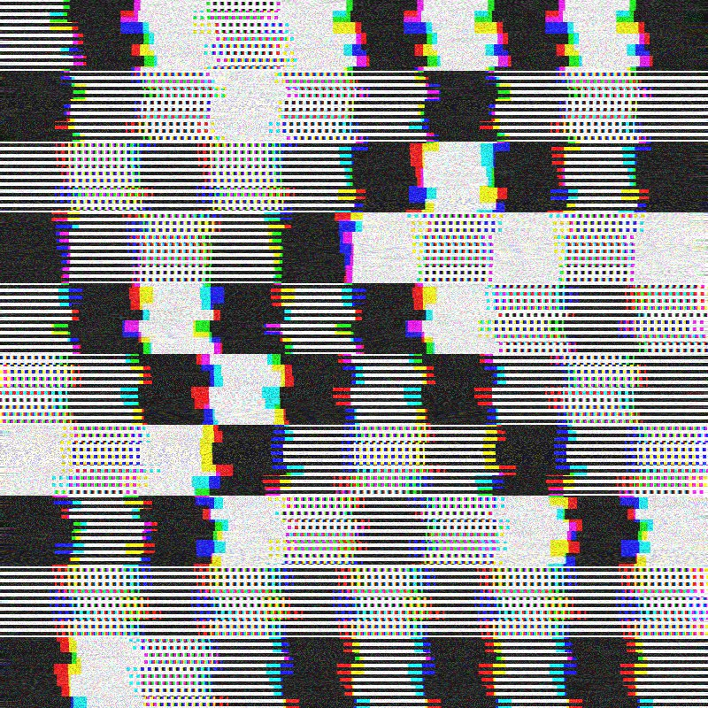

# p5B

[English](README.md) · 中文

> **非官方社区插件**：与 Processing Foundation（p5.js）和 Blender Foundation 均无隶属关系，也未获其背书。

在 **Blender 里写 p5.js**，把实时画布当作任意模型的纹理，通过 UV 决定它贴在哪里。
2D 画布是那扇"窗口"，UV 岛决定窗口在模型上开向哪儿。

[下载最新版](../../releases/latest) · [第三方声明](THIRD-PARTY.md) · [路线图](PLAN.md)



## 环境要求

- **Blender 4.2 或更新版本**（扩展平台）。已在 Blender 5.1 上实测。
- **一个 Chromium 内核的浏览器**：Chrome / Edge / Chromium，正常安装即可。
  sketch 真正跑在浏览器里，Blender 自带的 Python 没有网页引擎。
- 如果要用 `// @p5 2`（从 CDN 拉 p5.js-compatibility），需要在 Blender 里允许在线访问
  （`偏好设置 → 系统 → 允许在线访问`）。纯 p5 1.x 的 sketch 和插件自带的资源可以完全离线运行。
- 平台状态：**Windows 已实测**；macOS 和 Linux 的代码路径写了但**未验证**，
  试过的话请开 issue 附上 Blender 版本。

## 下载与安装

1. **[下载最新版](../../releases/latest)** → 选 `p5b-<版本号>.zip`（**不要解压**）。
2. Blender 4.2+ → `编辑 → 偏好设置 → 获取扩展 → 从磁盘安装…`。
3. 启用 **p5B**，然后在 3D 视图按 `N` 打开侧栏 → `p5B` 标签。

## 30 秒上手

1. `Sketch` 面板 → **Start**（启动）。一个隐藏的浏览器开始向 Blender 推流。
2. `Sketch` 面板 → **Edit**，sketch 会在文本编辑器里打开。把内容换成：

```js
function sketch(p) {
  p.setup = function () {
    p.createCanvas(640, 360);
  };
  p.draw = function () {
    p.background(10);
    p.fill(120, 220, 255);
    p.circle(p.width / 2 + p.sin(p.frameCount * 0.05) * 120, p.height / 2, 60);
  };
}
```

3. `Canvas` 面板 → **Show** 看实时画面，**Window Plane** 生成 2×2 画布，
   再点 **Bind Mesh** 把画布绑到当前选中的模型上。

停止输入后约 0.3 秒 sketch 会自动重跑（*Auto Run on Edit*）。只想要"一块平面上的像素"的话，不需要任何额外配置。

想让 Blender 驱动画面？跟踪一个空物体：

```js
p.draw = function () {
  p.background(8);
  const objects = (p.p5inblender.state.objects || []);
  objects.forEach(o => p.circle(o.x * p.width, o.y * p.height, 20));
};
```

选中任意空物体 → `Tracking → Track Selected`，它就会出现在 `state.objects` 里。

## 它能做什么

- 由一个真实浏览器执行你的 sketch（p5.js 1.x 或 2.x），Blender 每帧通过本地 socket 收像素。
- 像素落到 `Image` 数据块里，所以图像编辑器、EEVEE、Cycles 和视口都能实时看到画布。
- **Blender 里没有 JS 引擎**：浏览器是运行时，插件只是桥。
- 双向：JS 能读 Blender 状态（被跟踪物体、几何线框、上游纹理），Blender 能把画布写回图像。

## 用你自己的 p5 代码

p5js.org 上的绝大多数 sketch 可以直接跑。不是"实例模式"的，加一行头声明：

```js
// @lib https://cdn.jsdelivr.net/gh/antiboredom/p5.riso@master/lib/p5.riso.js
// @mode global      // 顶层 setup()/draw() 的老例子
// @p5 2             // 跑在 p5 2.x + p5.js-compatibility 上
```

## 画布坐标

画布是一块 **2×2 的正方形，平躺在 XY 平面**（和 `添加 → 网格 → 平面` 建出来的一模一样）。
一切都相对它计算，相机怎么摆都不影响：

```
u = 局部 x / 2 + 0.5        v = 0.5 − 局部 y / 2
visible = u, v ∈ [0, 1]     depth = 距画布的高度（沿法线）
```

sketch 图像是等比缩放进这块方片的（letterbox，从不拉伸），所以 `u, v` 是**图像内**坐标，不是方片内坐标。

## 材质

新建画布会拿到一个 Principled 材质：

- `Image → Base Color` **和** `Emission Color`（不打光也看得见），
- `Image.Alpha → P5B Alpha Ramp → Alpha`（开混合，透明背景在 Blender 里同样透明），
- 一个悬空的 `P5B Color Ramp`，接上就能做双色调/调色板效果。

`Canvas → Reset Material` 会就地重建它。**手工改过的材质不会被自动覆盖。**

## 面板

| 面板 | 内容 |
|---|---|
| **Sketch**（第一个） | 状态行、Start/Stop、Run/Edit、sketch 选择器、Follow Edited Text、Edit Externally、Reset Demo |
| **Canvas** | Show、Window Plane、Bind Mesh、Reset Material、Standardize Canvas、Show Live Info、上游 Texture 与"用自己的画布当纹理"、host 的打开/后台/关闭、端口与分辨率 |
| **Tracking** | Track Selected、Send Geometry、已跟踪与画面内计数 |
| **Render** | Cook、Cook + Render、Render Animation（逐帧拉取的确定性出片） |
| **Instances** | 多块互不干扰的画布，各自有自己的文本/图像/材质/端口 |

## 在外置编辑器里工作

Blender 的文本编辑器只有 Python 语法规则，JS 只能是纯文本。
`Sketch → Edit Externally` 会把 sketch 存到 `//p5b_sketches/`，用系统编辑器打开
（VS Code 配 `p5.vscode` 插件能拿到真正的 JS 高亮和代码补全），保存后约 0.3 秒同步回 Blender。

## p5 版本

- 默认：**p5 1.11.3**，已内置在 `host/libs/p5.min.js`（可离线）。
- `// @p5 2`：跑在 **p5 2.4.0** 上（同样内置），并在同源 iframe 里从 CDN 加载
  [p5.js-compatibility](https://github.com/processing/p5.js-compatibility) 的补丁
  （`preload`、`shapes`、`data`、`events`），让 1.x 时代的代码继续能用。

> 说明：p5.js 是 **LGPL-2.1**，不是 MIT。许可全文随插件放在
> [`host/libs/LICENSE-p5.txt`](host/libs/LICENSE-p5.txt)，细节见 [THIRD-PARTY.md](THIRD-PARTY.md)。

## 排错

| 症状 | 先查 |
|---|---|
| 画面完全不更新 | `Sketch` 面板的选择器是不是指向你正在改的那份？状态行的 `vN` 必须递增 |
| sketch 一直不出现 | `Canvas → Show` 打开实时图像；看状态行有没有 `sketch:` 报错 |
| 画面闪烁 | 连了好几个浏览器页面；最新且健康的客户端独占画布，关掉多余的标签页（看 `stale` 计数） |
| 更新一顿一顿 | `stale` 在涨，说明有被系统降频的后台标签页在抢 |
| 面板显示 `panel error:` | 那一行就是真实异常，请开 issue |
| 第一次更新很慢 | 每次运行都会在浏览器里重载 sketch，`setup()` 很重（编译 shader、建大画布）就要等 |
| 启动被拒绝，提示在线访问被关闭 | 打开 `偏好设置 → 系统 → 允许在线访问`，或用 `--online-mode` 启动 Blender |

## 开发

```
p5B/
├── __init__.py        插件入口：算子、面板、泵、cook
├── transport.py       单端口：HTTP 宿主页 + WebSocket 帧 + 原始 TCP v1
├── live_image.py      Image 数据块写入（sRGB 字节直通）
├── window.py          UV 窗口平面 + 默认材质
├── i18n.py            中英文 UI 文案
├── host/              浏览器宿主（index.html + 内置 p5 1.x / 2.x）
└── tools/             发布自检、合成发送端、基准、示例 sketch
```

Blender 5.1 / Windows 实测：640×360 约 60 fps，720p 上限约 127 fps，
cook 往返 10–52 ms，图像上传 0.69 ms（640×360）。

发布前跑一次自检：

```bash
python tools/check_release.py
```

## 许可

GPL-3.0-or-later —— 见 [LICENSE](LICENSE)。内置的两份 p5.js（1.11.3、2.4.0）是
**LGPL-2.1**：声明与许可全文在 [`host/libs/LICENSE-p5.txt`](host/libs/LICENSE-p5.txt)，
细节见 [THIRD-PARTY.md](THIRD-PARTY.md)。
